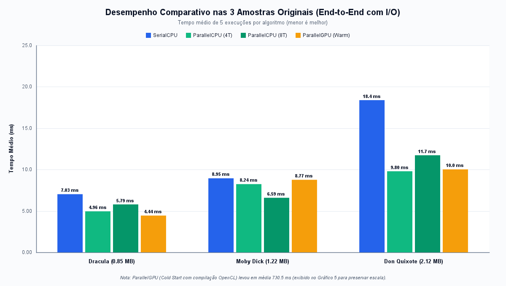
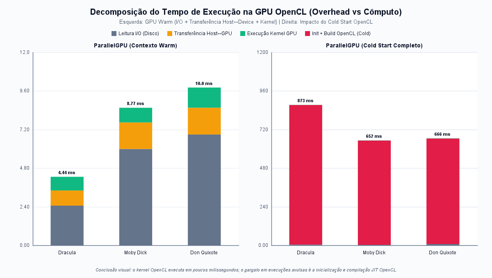
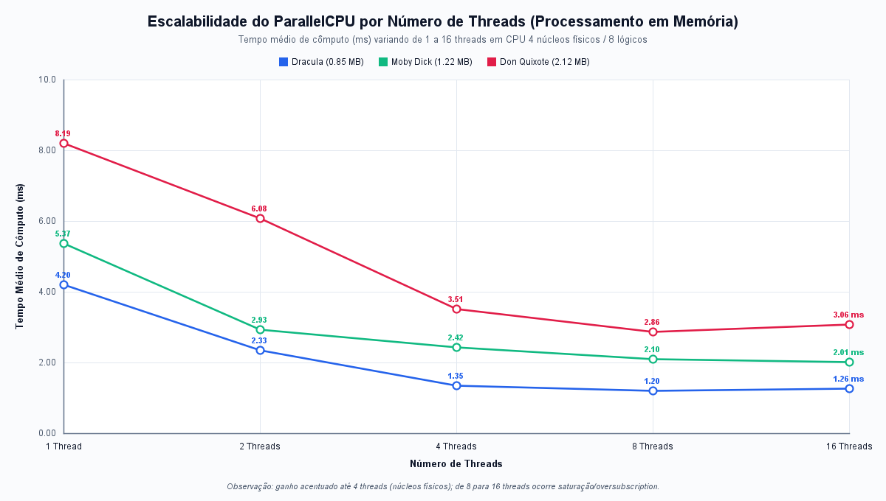
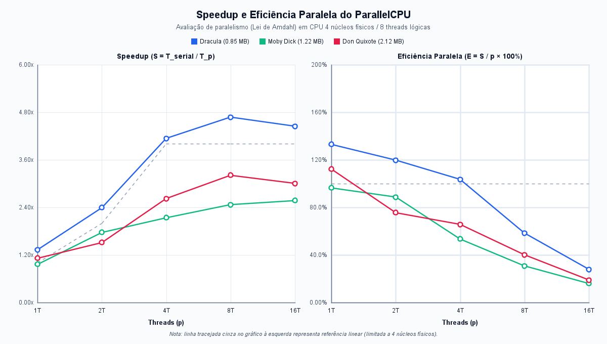
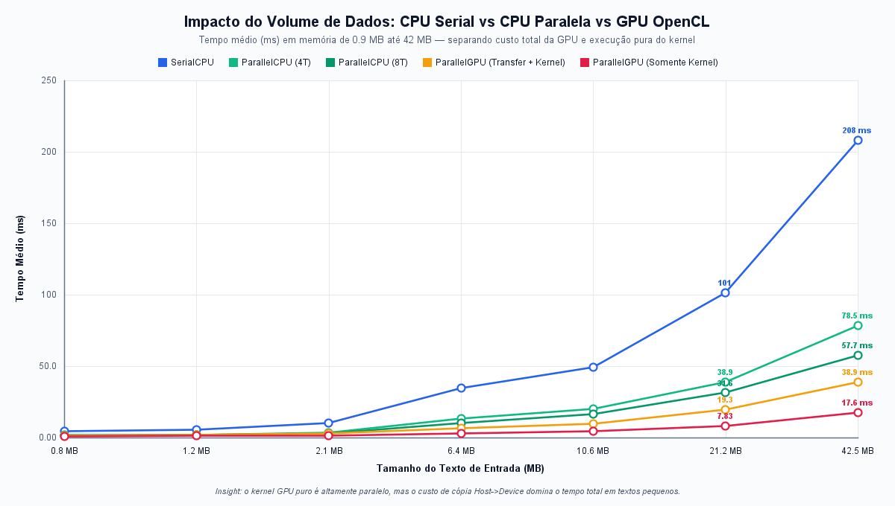

# Análise Comparativa de Algoritmos com Uso de Paralelismo (CPU Serial, CPU Paralela e GPU OpenCL)

> **Disciplina:** Computação Paralela e Distribuída — Atividade Extra  
> **Autor:** Anderson Viana Cataldo — Matrícula: `2410492`  
> **Linguagem / Bibliotecas:** Java (OpenJDK 25) + JOCL 2.0.4 (OpenCL) + Java Swing (`Graphics2D`)  
> **Repositório GitHub:** <https://github.com/andersoncataldo/analise-paralelismo-java-opencl>

---

## Sumário

1. [Resumo](#1-resumo)
2. [Introdução](#2-introdução)
3. [Metodologia e Guia de Execução](#3-metodologia-e-guia-de-execução)
4. [Resultados e Discussão](#4-resultados-e-discussão)
5. [Conclusão](#5-conclusão)
6. [Referências](#6-referências)
7. [Anexos — Códigos das Implementações](#7-anexos--códigos-das-implementações)

---

## 1. Resumo

Este trabalho apresenta uma análise empírica e estatística do desempenho de algoritmos de busca e contagem exata de palavras em arquivos de texto utilizando a linguagem Java sob três paradigmas distintos de execução: **sequencial em CPU (`SerialCPU`)**, **paralelo em CPU multicore com pool de threads (`ParallelCPU`)** e **paralelo em GPU utilizando OpenCL via biblioteca JOCL 2.0.4 (`ParallelGPU`)**.

Os experimentos foram conduzidos sobre três obras literárias de tamanhos e idiomas distintos (*Dracula* em inglês com 0,85 MB; *Moby Dick* em inglês com 1,22 MB; e *Don Quixote* em espanhol com 2,12 MB), além de uma bateria controlada de escalabilidade de threads em CPU (1, 2, 4, 8 e 16 threads) e de escalabilidade por volume de dados (de 0,85 MB até 42,45 MB). Todos os tempos foram coletados com 5 amostras por cenário (e 3 amostras adicionais para avaliação de *Cold Start* em OpenCL), registrados em arquivos CSV e visualizados por meio de gráficos gerados nativamente em **Java Swing (`Graphics2D`)**.

Os resultados demonstram que: (i) os três algoritmos atingem **100% de consistência nas contagens** mediante verificação rigorosa de fronteiras de palavra tanto na CPU quanto no kernel OpenCL; (ii) em execuções avulsas (*Cold Start*), a inicialização do contexto OpenCL e compilação JIT do kernel (~652 ms a 873 ms) torna a GPU inviável para textos pequenos; (iii) com o contexto OpenCL reaproveitado (*Warm*), o kernel GPU atinge **speedups de 4,7x a 12,96x** sobre a CPU serial no cômputo puro e supera a CPU paralela de 8 threads em tempo total (incluindo transferência Host↔GPU) a partir de **~2,1 MB** de texto, chegando a **38,94 ms contra 57,70 ms (CPU 8T) e 207,95 ms (SerialCPU)** em 42,45 MB.

---

## 2. Introdução

O crescimento contínuo do volume de dados textuais processados por mecanismos de busca, sistemas de indexação, análise de logs e processamento de linguagem natural exige o aproveitamento eficiente de arquiteturas modernas de hardware. Embora processadores modernos contem com múltiplos núcleos físicos e threads simultâneas (*Simultaneous Multithreading / Hyper-Threading*), Unidades de Processamento Gráfico (GPUs) oferecem dezenas de unidades computacionais (*Compute Units*) otimizadas para paralelismo massivo de dados (*SIMD / SIMT*).

Entretanto, paralelizar um problema não garante automaticamente ganho de desempenho. Conforme formalizado pela **Lei de Amdahl**, o ganho de velocidade (*speedup*) é limitado pela fração sequencial do programa (como leitura de disco, criação de threads, compilação de kernels e transferência de buffers entre memória principal e memória da GPU) e pela sobrecarga de sincronização.

### Métodos Escolhidos e Abordagem

Para investigar quantitativamente esses trade-offs, o sistema foi estruturado com três métodos de contagem exata de palavras (*case-insensitive*, respeitando fronteiras de palavra e caracteres acentuados do bloco Latin-1):

1. **`SerialCPU` (CPU Sequencial):**
   - Implementa um laço simples (`while`) que percorre linearmente o vetor de caracteres do texto, identifica o início e o término de cada palavra através de caracteres delimitadores e compara caractere a caractere com a palavra buscada.
   - Serve como linha de base (*baseline*) para cálculo de *speedup* e eficiência paralela, além de referência de corretude para validação das versões paralelas.

2. **`ParallelCPU` (CPU Paralela Multicore):**
   - Utiliza um pool de threads (`java.util.concurrent.ExecutorService` via `Executors.newFixedThreadPool(numThreads)`) para particionar o texto em blocos equilibrados.
   - **Alinhamento seguro de fronteiras:** ao calcular os índices de corte entre partições, o algoritmo avança cada fronteira para fora de qualquer palavra em andamento (`computeWordSafeBoundaries`), impedindo que uma palavra seja partida ao meio entre duas threads — eliminando condições de corrida e necessidade de bloqueios (*locks*) durante a contagem.
   - Cada tarefa (`Callable<Long>`) contabiliza seu segmento de forma independente e a thread principal agrega os resultados parciais via `Future<Long>`.

3. **`ParallelGPU` (GPU Paralela com OpenCL / JOCL 2.0.4):**
   - Utiliza a biblioteca **JOCL 2.0.4** para executar um kernel escrito em **OpenCL C** diretamente nas 24 *Compute Units* da GPU.
   - **Estratégia do Kernel (`countWordOccurrences`):**
     - O vetor de caracteres UTF-16 (`char[]` em Java, 16 bits) é enviado diretamente como `__global const ushort*` via `Pointer.to(text)`, evitando cópias intermediárias na CPU.
     - Cada *work-item* percorre posições do texto em padrão **grid-stride** (`idx += get_global_size(0)`), promovendo acesso coalescido à memória.
     - Antes de comparar os caracteres, cada *work-item* verifica explicitamente as fronteiras inicial (`idx == 0 || !isWordChar(text[idx - 1])`) e final (`endIdx == textLen || !isWordChar(text[endIdx])`). Isso resolve o erro clássico de implementações ingênuas em GPU que contam substrings indevidas (por exemplo, contar `"the"` dentro de `"there"` ou `"whale"` dentro de `"whales"`), garantindo **exatamente a mesma contagem** dos métodos em CPU.
     - Para evitar contenção em operações atômicas globais, cada *work-item* acumula em registrador privado e realiza uma **redução em árvore em memória local (`__local uint*`)** dentro do *work-group* (tamanho 256), escrevendo apenas 1 soma parcial por *work-group* na memória global.

---

## 3. Metodologia e Guia de Execução

### 3.1 Ambiente Experimental (Hardware e Software)

| Componente | Especificação |
| :--- | :--- |
| **Processador (CPU)** | Intel® Core™ i5-10210U @ 1.60 GHz (4 núcleos físicos / 8 threads lógicas) |
| **Placa Gráfica (GPU)** | Intel® UHD Graphics — 24 Compute Units, Max Work-Group Size = 256, 4.847 MB Global Mem |
| **Runtime OpenCL** | Intel® OpenCL HD Graphics — OpenCL 2.1 NEO |
| **Memória RAM** | 12 GB (12.707 MB) |
| **Sistema Operacional** | Windows 10/11 (64 bits) |
| **Plataforma Java** | OpenJDK 25.0.5.1 LTS (Eclipse Adoptium HotSpot 64-Bit Server VM) |
| **Biblioteca GPU** | `jocl-2.0.4.jar` (Java Bindings for OpenCL) |
| **Visualização Gráfica** | Java Swing (`javax.swing` + `java.awt.Graphics2D`) com exportação PNG nativa |

### 3.2 Conjuntos de Dados (Amostras)

Foram utilizadas as três amostras fornecidas em anexo (obras do *Project Gutenberg*), variando tamanho em bytes, quantidade de palavras e idioma (inglês e espanhol com acentuação):

| Dataset | Arquivo | Tamanho | Caracteres | Idioma | Palavra Alvo | Ocorrências Exatas |
| :--- | :--- | :---: | :---: | :---: | :---: | :---: |
| **Dracula** | `Dracula-165307.txt` | 0,85 MB (890.389 B) | 881.021 | Inglês | `blood` | **113** |
| **Moby Dick** | `MobyDick-217452.txt` | 1,22 MB (1.276.285 B) | 1.260.539 | Inglês | `whale` | **1.244** |
| **Don Quixote** | `DonQuixote-388208.txt` | 2,12 MB (2.225.840 B) | 2.168.073 | Espanhol | `quijote` | **2.245** |

Adicionalmente, no **Experimento 3**, foram geradas em memória replicações controladas de *Don Quixote* (**3x, 5x, 10x e 20x**, alcançando **42,45 MB** e **43.361.480 caracteres**) separadas por quebra de linha para avaliar o comportamento assintótico de CPU vs GPU sob grandes volumes de massa.

### 3.3 Protocolo Experimental e Análise Estatística

Para garantir rigor estatístico e reprodutibilidade:
- **Aquecimento (*Warm-up*):** Antes das medições, executam-se rodadas de aquecimento para estabilizar a compilação JIT (*Just-In-Time*) da JVM, o cache de arquivos do sistema operacional e o contexto OpenCL.
- **Amostragem:** Foram coletadas **5 amostras medidas** para cada combinação de algoritmo, dataset, número de threads e volume de dados (superando o mínimo exigido de 3 amostras), além de **3 amostras dedicadas** para o cenário de *Cold Start* OpenCL (criação de contexto + compilação do kernel a cada chamada).
- **Decomposição de Tempos:** Cada execução registra com precisão de nanossegundos (`System.nanoTime()`):
  - `tempo_total_ms`: tempo ponta a ponta (*end-to-end*);
  - `tempo_io_ms`: tempo de leitura do arquivo `.txt` em disco;
  - `tempo_setup_transfer_ms`: criação de pool (CPU) ou inicialização OpenCL + transferência Host↔Device (GPU);
  - `tempo_computo_ms`: execução pura do algoritmo de contagem (ou execução pura do kernel na GPU).
- **Métricas Estatísticas Calculadas (`StatisticsUtil.java`):**
  - Média aritmética ($\bar{t}$), desvio padrão amostral ($s$), mínimo e máximo;
  - **Speedup:** $S(p) = \frac{T_{\text{serial}}}{T_p}$;
  - **Eficiência Paralela:** $E(p) = \frac{S(p)}{p} \times 100\%$, onde $p$ é o número de threads (CPU) ou *Compute Units* (GPU).
- **Validação Automática:** A cada amostra, o framework aplica `verifyExactMatch(...)`, interrompendo a suíte com `AssertionError` caso qualquer algoritmo retorne contagem diferente do `SerialCPU`.
- **Arquivos CSV Gerados (`resultados/`):**
  - [`resultados/resultados_detalhados.csv`](resultados/resultados_detalhados.csv) — todas as execuções individuais por amostra;
  - [`resultados/resultados_resumo.csv`](resultados/resultados_resumo.csv) — consolidação estatística do Experimento 1;
  - [`resultados/resultados_nucleos_cpu.csv`](resultados/resultados_nucleos_cpu.csv) — escalabilidade de threads na CPU (Experimento 2);
  - [`resultados/resultados_volume_gpu.csv`](resultados/resultados_volume_gpu.csv) — escalabilidade por volume de dados CPU vs GPU (Experimento 3).

### 3.4 Estrutura do Projeto, Dependências e Instruções de Execução

> **IMPORTANTE (Biblioteca Obrigatória para Correção):**  
> Este projeto utiliza a biblioteca **JOCL 2.0.4** (`jocl-2.0.4.jar`). O arquivo `.jar` já está incluído e deve permanecer exatamente no diretório **`lib/jocl-2.0.4.jar`** na raiz do projeto. Não é necessária nenhuma outra biblioteca externa (os gráficos e a interface gráfica utilizam apenas **Java Swing** nativo do JDK). É necessário que a máquina possua um driver OpenCL instalado (Intel, AMD ou NVIDIA) e JDK 17+ (testado no OpenJDK 25).

```text
ATIVIDADE EXTRA - ENTREGA 01.12/
├── lib/
│   └── jocl-2.0.4.jar                 <-- BIBLIOTECA OBRIGATÓRIA (JOCL 2.0.4)
├── amostras/
│   ├── Dracula-165307.txt
│   ├── MobyDick-217452.txt
│   └── DonQuixote-388208.txt
├── src/br/com/paralelismo/
│   ├── Main.java                      <-- Ponto de entrada (CLI, Benchmark e Swing GUI)
│   ├── model/                         <-- SearchResult.java, DatasetConfig.java
│   ├── algorithms/                    <-- TextUtils.java, SerialCPU.java, ParallelCPU.java, ParallelGPU.java
│   ├── benchmark/                     <-- BenchmarkRunner.java, StatisticsUtil.java, CsvExporter.java
│   └── ui/                            <-- ChartGenerator.java, DashboardSwing.java
├── resultados/                        <-- Arquivos CSV gerados automaticamente
├── graficos/                          <-- Gráficos PNG gerados pelo Java Swing
├── compilar.bat                       <-- Script de compilação (Windows)
├── executar.bat                       <-- Script de execução (Windows)
├── README.md                          <-- Relatório completo
└── README.pdf                         <-- Versão PDF para entrega
```

#### Como Compilar e Executar (Windows / PowerShell ou CMD)

**Opção 1 — Usando os scripts `.bat` inclusos:**
```bat
compilar.bat
executar.bat --gui
```

**Opção 2 — Linha de comando manual:**
```bash
# 1. Compilar (incluindo lib/jocl-2.0.4.jar no classpath)
mkdir out
javac -encoding UTF-8 -cp "lib/jocl-2.0.4.jar" -d out src/br/com/paralelismo/model/*.java src/br/com/paralelismo/algorithms/*.java src/br/com/paralelismo/benchmark/*.java src/br/com/paralelismo/ui/*.java src/br/com/paralelismo/Main.java

# 2. Executar suíte completa de benchmarks + gerar CSVs + gerar PNGs (sem abrir janela)
java --enable-native-access=ALL-UNNAMED -cp "out;lib/jocl-2.0.4.jar" br.com.paralelismo.Main --benchmark

# 3. Executar suíte completa + abrir Dashboard interativo Java Swing (EXTRA)
java --enable-native-access=ALL-UNNAMED -cp "out;lib/jocl-2.0.4.jar" br.com.paralelismo.Main --gui

# 4. Executar busca individual em um arquivo .txt e palavra específica
java --enable-native-access=ALL-UNNAMED -cp "out;lib/jocl-2.0.4.jar" br.com.paralelismo.Main --search amostras/Dracula-165307.txt blood 4
```
*(Em Linux/macOS, substitua `;` por `:` no parâmetro `-cp`. Em JDK 17–21, a flag `--enable-native-access=ALL-UNNAMED` é opcional; em JDK 24+, ela evita avisos de acesso nativo da JOCL).*

---

## 4. Resultados e Discussão

### 4.1 Experimento 1 — Comparativo nas 3 Amostras Originais (End-to-End com I/O)

Em todas as execuções, os três algoritmos retornaram contagens rigorosamente idênticas: **113 ocorrências** de `"blood"` em *Dracula*, **1.244 ocorrências** de `"whale"` em *Moby Dick* e **2.245 ocorrências** de `"quijote"` em *Don Quixote*.

| Dataset (Palavra / Ocorr.) | Algoritmo | Média Total (ms) | Desvio Padrão (ms) | I/O Médio (ms) | Setup / Transf. (ms) | Cômputo / Kernel (ms) | Speedup Total | Speedup Cômputo |
| :--- | :--- | :---: | :---: | :---: | :---: | :---: | :---: | :---: |
| **Dracula (0,85 MB)**<br>`blood` (113) | `SerialCPU` | 7,03 | ±1,82 | 2,91 | 0,00 | 4,01 | 1,00x | 1,00x |
| | `ParallelCPU (4T)` | 4,96 | ±1,47 | 3,01 | 0,06 | 1,77 | 1,42x | 2,26x |
| | `ParallelCPU (8T)` | 5,79 | ±3,09 | 4,04 | 0,06 | 1,59 | 1,21x | 2,52x |
| | `ParallelGPU (Warm)` | **4,44** | ±1,56 | 2,47 | 0,94 | **0,85** | **1,58x** | **4,71x** |
| | `ParallelGPU (Cold)` | 873,49 | ±173,34 | 4,07 | 868,36 | 0,77 | 0,01x | 5,23x |
| **Moby Dick (1,22 MB)**<br>`whale` (1.244) | `SerialCPU` | 8,95 | ±1,57 | 3,48 | 0,00 | 5,38 | 1,00x | 1,00x |
| | `ParallelCPU (4T)` | 8,24 | ±1,64 | 5,45 | 0,10 | 2,39 | 1,09x | 2,25x |
| | `ParallelCPU (8T)` | **6,59** | ±3,04 | 3,47 | 0,06 | 2,96 | **1,36x** | 1,81x |
| | `ParallelGPU (Warm)` | 8,77 | ±3,02 | 5,99 | 1,65 | **0,91** | 1,02x | **5,89x** |
| | `ParallelGPU (Cold)` | 652,36 | ±14,74 | 2,70 | 648,53 | 0,89 | 0,01x | 6,05x |
| **Don Quixote (2,12 MB)**<br>`quijote` (2.245) | `SerialCPU` | 18,39 | ±3,49 | 8,33 | 0,00 | 9,91 | 1,00x | 1,00x |
| | `ParallelCPU (4T)` | **9,80** | ±3,09 | 5,37 | 0,09 | 4,15 | **1,88x** | 2,39x |
| | `ParallelCPU (8T)` | 11,73 | ±2,01 | 8,26 | 0,08 | 3,29 | 1,57x | 3,02x |
| | `ParallelGPU (Warm)` | 10,03 | ±2,94 | 6,89 | 1,67 | **1,25** | 1,83x | **7,91x** |
| | `ParallelGPU (Cold)` | 665,65 | ±24,67 | 7,69 | 656,09 | 1,30 | 0,03x | 7,65x |



**Análise dos Padrões Observados (Experimento 1):**
- **Fração Sequencial de I/O (Lei de Amdahl):** Nos arquivos originais (0,85 MB a 2,12 MB), a leitura do disco (`I/O`) consome entre **40% e 68% do tempo total** nas versões paralelas (ex.: em *Don Quixote*, dos 10,03 ms da `ParallelGPU (Warm)`, 6,89 ms são leitura de arquivo). Isso limita o *speedup end-to-end* a ~1,4x–1,9x mesmo quando o cômputo puro acelera de 2,4x até **7,91x**.
- **Impacto do Cold Start em OpenCL:** Conforme ilustrado no Gráfico 5 abaixo, quando o contexto OpenCL é criado e o kernel é compilado em tempo de execução a cada busca (`ParallelGPU Cold`), o tempo salta para **652 ms – 873 ms** — mais de **98% desse tempo** é gasto na inicialização do driver e compilação JIT do programa OpenCL, enquanto o kernel em si executa em **~0,8 ms a 1,3 ms**. Isso explica perfeitamente resultados práticos onde uma chamada isolada em GPU aparenta ser dezenas de vezes mais lenta que a CPU serial.



---

### 4.2 Experimento 2 — Escalabilidade por Número de Núcleos/Threads na CPU

Isolando o processamento em memória (sem I/O de disco) e variando o número de threads do `ExecutorService` em **1, 2, 4, 8 e 16 threads**, obteve-se a seguinte curva de escalabilidade no processador Intel Core i5-10210U (4 núcleos físicos / 8 threads lógicas):

| Dataset | 1 Thread (ms) | 2 Threads (ms) | 4 Threads (ms) | 8 Threads (ms) | 16 Threads (ms) | Melhor Speedup | Eficiência em 4T | Eficiência em 16T |
| :--- | :---: | :---: | :---: | :---: | :---: | :---: | :---: | :---: |
| **Dracula (0,85 MB)** | 4,20 (±2,16) | 2,33 (±1,11) | 1,35 (±0,08) | **1,20** (±0,09) | 1,26 (±0,07) | **4,67x** (8T) | 103,5%* | 27,8% |
| **Moby Dick (1,22 MB)** | 5,37 (±1,30) | 2,93 (±1,31) | 2,42 (±0,98) | 2,10 (±0,98) | **2,01** (±0,89) | **2,58x** (16T) | 53,6% | 16,1% |
| **Don Quixote (2,12 MB)** | 8,19 (±2,00) | 6,08 (±1,74) | 3,51 (±1,75) | **2,86** (±1,54) | 3,06 (±1,81) | **3,21x** (8T) | 65,6% | 18,8% |

*\*Nota metodológica:* Em microbenchmarks de curtíssima duração (~1–4 ms como *Dracula*), efeitos de localidade de cache L2/L3 (partições menores cabem integralmente na cache de cada núcleo) somados à variação de frequência *Intel Turbo Boost* podem produzir eficiências aparentes ligeiramente acima de 100% (*speedup* superlinear).





**Análise dos Padrões Observados (Experimento 2):**
1. **Região de Ganho Forte (1 → 2 → 4 threads):** A queda no tempo de execução é acentuada até 4 threads, correspondendo diretamente aos **4 núcleos físicos** do processador. Em *Don Quixote*, o tempo cai de 8,19 ms (1T) para 3,51 ms (4T) com **65,6% de eficiência**.
2. **Região de Retorno Decrescente (4 → 8 threads):** Entre 4 e 8 threads, o ganho adicional provém do *Hyper-Threading* (SMT), que compartilha unidades de execução nos mesmos 4 núcleos físicos. O tempo ainda melhora levemente (ex.: 3,51 ms → 2,86 ms em *Don Quixote*), mas a eficiência cai para **30%–58%**.
3. **Região de Saturação / *Oversubscription* (8 → 16 threads):** Ao criar 16 threads (o dobro das threads lógicas disponíveis), não há ganho relevante e ocorre leve degradação em *Dracula* (1,20 → 1,26 ms) e *Don Quixote* (2,86 → 3,06 ms) devido à contenção de cache e troca de contexto do escalonador do sistema operacional, derrubando a eficiência para **16%–28%**.

---

### 4.3 Experimento 3 — Impacto do Volume de Dados (CPU Serial vs CPU Paralela vs GPU OpenCL)

Para investigar a partir de qual volume de entrada a arquitetura massivamente paralela da GPU compensa o custo de transferência de memória Host↔Device, executou-se o comparativo em memória desde **0,85 MB até 42,45 MB**:

| Volume de Entrada | Ocorrências | `SerialCPU` (ms) | `ParallelCPU 4T` (ms) | `ParallelCPU 8T` (ms) | `ParallelGPU` Total Warm (ms) | `ParallelGPU` Transfer (ms) | `ParallelGPU` Kernel (ms) | Speedup GPU Total vs Serial | Speedup GPU Kernel vs Serial |
| :--- | :---: | :---: | :---: | :---: | :---: | :---: | :---: | :---: | :---: |
| **0,85 MB** (Dracula) | 113 | 4,20 | 2,08 | **1,26** | 1,29 | 0,52 | 0,77 | 3,26x | 5,46x |
| **1,22 MB** (Moby Dick) | 1.244 | 5,34 | **1,72** | **1,72** | 2,06 | 0,67 | 1,39 | 2,60x | 3,85x |
| **2,12 MB** (Don Quixote 1x) | 2.245 | 10,08 | 3,46 | 3,01 | **2,70** | 1,50 | 1,20 | **3,73x** | 8,42x |
| **6,37 MB** (Don Quixote 3x) | 6.735 | 34,71 | 13,27 | 10,12 | **6,62** | 3,50 | 3,12 | **5,24x** | 11,11x |
| **10,61 MB** (Don Quixote 5x) | 11.225 | 49,30 | 19,88 | 16,65 | **9,59** | 5,06 | 4,53 | **5,14x** | 10,89x |
| **21,23 MB** (Don Quixote 10x) | 22.450 | 101,45 | 38,93 | 31,62 | **19,33** | 11,50 | 7,83 | **5,25x** | **12,96x** |
| **42,45 MB** (Don Quixote 20x) | 44.900 | 207,95 | 78,48 | 57,70 | **38,94** | 21,29 | 17,65 | **5,34x** | 11,78x |



**Análise dos Padrões Observados (Experimento 3):**
- **Ponto de Cruzamento (*Break-Even Point*):** Em massas pequenas (0,85 MB e 1,22 MB), `ParallelCPU (8T)` empata ou supera ligeiramente `ParallelGPU (Warm)` (1,72 ms vs 2,06 ms em *Moby Dick*), porque o tempo de transferência de buffer e despacho de fila OpenCL representa ~33%–40% do tempo total. A partir de **2,12 MB**, a GPU assume a liderança definitiva e amplia continuamente a vantagem!
- **Desempenho em Alto Volume (42,45 MB / 43,36 milhões de caracteres):**
  - `SerialCPU`: **207,95 ms** (~208 Mchars/s);
  - `ParallelCPU (4T)`: **78,48 ms** (speedup **2,65x**);
  - `ParallelCPU (8T)`: **57,70 ms** (speedup **3,60x**);
  - `ParallelGPU (Transfer + Kernel)`: **38,94 ms** (speedup **5,34x** sobre SerialCPU e **1,48x mais rápida** que CPU 8T);
  - `ParallelGPU (Somente Kernel)`: **17,65 ms** (speedup **11,78x** sobre SerialCPU — alcançando **~2,46 bilhões de caracteres/segundo** nas 24 Compute Units integradas!).
- **Gargalo de Memória (*Memory-Bound*):** Nota-se que mesmo em 42,45 MB, a transferência de memória Host→Device (`21,29 ms`) ainda excede o tempo de computação do kernel (`17,65 ms`). Como a busca de palavras realiza poucas operações aritméticas por byte lido (baixa intensidade aritmética), o algoritmo é fortemente limitado por largura de banda de memória. Em arquiteturas de múltiplas consultas sobre o mesmo corpus já residente na GPU, apenas o tempo de kernel (17,65 ms) seria pago por consulta.

---

## 5. Conclusão

Este estudo comprovou empiricamente que **não existe um paradigma universalmente ótimo** para busca e contagem de palavras; a escolha ideal depende diretamente do **volume de dados**, da **frequência de consultas** (reuso de contexto) e da **arquitetura de hardware disponível**:

1. **Quando usar `SerialCPU`:** Adequado apenas para arquivos muito pequenos (< 200 KB) ou scripts simples de execução única, onde a simplicidade de código supera ganhos de poucos milissegundos.
2. **Quando usar `ParallelCPU`:** É a **melhor escolha geral** para arquivos pequenos e médios (0,5 MB a ~2 MB) ou execuções avulsas em linha de comando, pois evita a penalidade de inicialização da GPU (~700 ms) e alcança aceleração imediata de **2,1x a 3,6x** ajustando o pool de threads ao número de núcleos físicos/lógicos (4 a 8 threads neste hardware, evitando *oversubscription* em 16+ threads).
3. **Quando usar `ParallelGPU` (OpenCL):** Torna-se superior em **grandes volumes de dados (> 2 MB)** e, especialmente, em **serviços persistentes ou processamento em lote (*batch*)** nos quais o contexto OpenCL e o kernel compilado são inicializados uma única vez e reutilizados em múltiplas buscas — atingindo até **5,34x de speedup total** e **12,96x de speedup de kernel** mesmo em uma GPU integrada Intel UHD Graphics.

Por fim, o desenvolvimento da interface gráfica em **Java Swing** e a exportação automatizada em **CSV** e **PNG** fornecem uma ferramenta reproduzível, didática e extensível para novas investigações em computação paralela e heterogênea.

---

## 6. Referências

- AMDAHL, G. M. **Validity of the single processor approach to achieving large scale computing capabilities**. In: *Proceedings of the April 18–20, 1967, Spring Joint Computer Conference (AFIPS '67)*. New York: ACM, 1967. p. 483–485.
- KHRONOS GROUP. **The OpenCL Specification — Version 2.1**. Beaverton: Khronos OpenCL Working Group, 2015. Disponível em: <https://www.khronos.org/opencl/>.
- JOCL. **JOCL — Java Bindings for OpenCL (versão 2.0.4)**. Disponível em: <http://www.jocl.org/>.
- ORACLE. **Java Platform, Standard Edition — `java.util.concurrent.ExecutorService` & Java Swing Documentation**. Disponível em: <https://docs.oracle.com/en/java/>.
- PACHECO, P. S.; MALENSEK, M. **An Introduction to Parallel Programming**. 2. ed. Cambridge: Morgan Kaufmann, 2021.
- PROJECT GUTENBERG. **Obras de Domínio Público**: *Dracula* (Bram Stoker, #345), *Moby Dick* (Herman Melville, #2701) e *Don Quijote* (Miguel de Cervantes, #2000). Disponível em: <https://www.gutenberg.org/>.

---

## 7. Anexos — Códigos das Implementações

### Anexo A — `TextUtils.java` (Regras Unificadas de Fronteira e Normalização)

```java
package br.com.paralelismo.algorithms;

import java.io.IOException;
import java.nio.charset.StandardCharsets;
import java.nio.file.Files;
import java.nio.file.Path;

public final class TextUtils {

    private TextUtils() {}

    public static char[] readFileChars(Path filePath) throws IOException {
        String content = Files.readString(filePath, StandardCharsets.UTF_8);
        return content.toCharArray();
    }

    public static char[] normalizeWord(String word) {
        if (word == null || word.isEmpty()) {
            throw new IllegalArgumentException("A palavra de busca não pode ser vazia.");
        }
        char[] chars = word.trim().toCharArray();
        for (int i = 0; i < chars.length; i++) {
            chars[i] = toLowerChar(chars[i]);
        }
        return chars;
    }

    public static boolean isWordChar(char c) {
        return (c >= 'a' && c <= 'z')
                || (c >= 'A' && c <= 'Z')
                || (c >= '0' && c <= '9')
                || (c >= 0x00C0 && c <= 0x00FF && c != 0x00D7 && c != 0x00F7);
    }

    public static char toLowerChar(char c) {
        if (c >= 'A' && c <= 'Z') return (char) (c + 32);
        if (c >= 0x00C0 && c <= 0x00DE && c != 0x00D7) return (char) (c + 32);
        return c;
    }
}
```

### Anexo B — `SerialCPU.java` (Versão Serial na CPU)

```java
package br.com.paralelismo.algorithms;

import br.com.paralelismo.model.SearchResult;
import java.io.IOException;
import java.nio.file.Files;
import java.nio.file.Path;

public class SerialCPU {

    public SearchResult countWord(Path filePath, String targetWord, int sampleIndex) throws IOException {
        long startTotal = System.nanoTime();
        long fileBytes = Files.size(filePath);

        long startIo = System.nanoTime();
        char[] text = TextUtils.readFileChars(filePath);
        long endIo = System.nanoTime();

        char[] word = TextUtils.normalizeWord(targetWord);

        long startCompute = System.nanoTime();
        long count = countInRange(text, 0, text.length, word);
        long endCompute = System.nanoTime();

        long endTotal = System.nanoTime();

        return new SearchResult(
                "SerialCPU", filePath.getFileName().toString(), fileBytes, text.length,
                targetWord, 1, sampleIndex, count,
                (endTotal - startTotal) / 1_000_000.0,
                (endIo - startIo) / 1_000_000.0, 0.0,
                (endCompute - startCompute) / 1_000_000.0,
                "Execução sequencial single-thread"
        );
    }

    public static long countInRange(char[] text, int start, int end, char[] word) {
        int wordLen = word.length;
        long count = 0;
        int i = start;

        while (i < end) {
            while (i < end && !TextUtils.isWordChar(text[i])) i++;
            if (i >= end) break;

            int wordStart = i;
            while (i < end && TextUtils.isWordChar(text[i])) i++;

            if (i - wordStart == wordLen) {
                boolean match = true;
                for (int j = 0; j < wordLen; j++) {
                    if (TextUtils.toLowerChar(text[wordStart + j]) != word[j]) {
                        match = false;
                        break;
                    }
                }
                if (match) count++;
            }
        }
        return count;
    }
}
```

### Anexo C — `ParallelCPU.java` (Versão Paralela na CPU com Pool de Threads)

```java
package br.com.paralelismo.algorithms;

import br.com.paralelismo.model.SearchResult;
import java.io.IOException;
import java.nio.file.Files;
import java.nio.file.Path;
import java.util.ArrayList;
import java.util.List;
import java.util.concurrent.*;

public class ParallelCPU {

    private final int numThreads;

    public ParallelCPU(int numThreads) {
        this.numThreads = numThreads;
    }

    public SearchResult countWord(Path filePath, String targetWord, int sampleIndex) throws IOException {
        long startTotal = System.nanoTime();
        long fileBytes = Files.size(filePath);

        long startIo = System.nanoTime();
        char[] text = TextUtils.readFileChars(filePath);
        long endIo = System.nanoTime();

        char[] word = TextUtils.normalizeWord(targetWord);

        long startSetup = System.nanoTime();
        ExecutorService pool = Executors.newFixedThreadPool(numThreads);
        long endSetup = System.nanoTime();

        long count;
        long startCompute = System.nanoTime();
        try {
            count = executeParallelCount(pool, text, word, numThreads);
        } finally {
            pool.shutdown();
        }
        long endCompute = System.nanoTime();
        long endTotal = System.nanoTime();

        return new SearchResult(
                "ParallelCPU", filePath.getFileName().toString(), fileBytes, text.length,
                targetWord, numThreads, sampleIndex, count,
                (endTotal - startTotal) / 1_000_000.0,
                (endIo - startIo) / 1_000_000.0,
                (endSetup - startSetup) / 1_000_000.0,
                (endCompute - startCompute) / 1_000_000.0,
                "ExecutorService com " + numThreads + " thread(s)"
        );
    }

    private static long executeParallelCount(ExecutorService pool, char[] text, char[] word, int numTasks) {
        int len = text.length;
        int effectiveTasks = Math.min(numTasks, Math.max(1, len / 1024));
        if (effectiveTasks <= 1) return SerialCPU.countInRange(text, 0, len, word);

        int[] boundaries = computeWordSafeBoundaries(text, effectiveTasks);
        List<Callable<Long>> tasks = new ArrayList<>(effectiveTasks);
        for (int t = 0; t < effectiveTasks; t++) {
            final int start = boundaries[t];
            final int end = boundaries[t + 1];
            tasks.add(() -> SerialCPU.countInRange(text, start, end, word));
        }

        long total = 0;
        try {
            for (Future<Long> f : pool.invokeAll(tasks)) {
                total += f.get();
            }
        } catch (InterruptedException e) {
            Thread.currentThread().interrupt();
            throw new RuntimeException(e);
        } catch (ExecutionException e) {
            throw new RuntimeException(e.getCause());
        }
        return total;
    }

    private static int[] computeWordSafeBoundaries(char[] text, int partitions) {
        int len = text.length;
        int[] bounds = new int[partitions + 1];
        bounds[0] = 0;
        bounds[partitions] = len;
        int chunkSize = len / partitions;
        for (int i = 1; i < partitions; i++) {
            int pos = Math.max(bounds[i - 1], i * chunkSize);
            while (pos < len && TextUtils.isWordChar(text[pos])) pos++;
            bounds[i] = pos;
        }
        return bounds;
    }
}
```

### Anexo D — `ParallelGPU.java` (Kernel OpenCL C e Orquestração JOCL 2.0.4)

```c
// Kernel OpenCL C embarcado em ParallelGPU.java
inline int isWordChar(ushort c) {
    return (c >= 'a' && c <= 'z') ||
           (c >= 'A' && c <= 'Z') ||
           (c >= '0' && c <= '9') ||
           (c >= 0x00C0 && c <= 0x00FF && c != 0x00D7 && c != 0x00F7);
}

inline ushort toLowerChar(ushort c) {
    if (c >= 'A' && c <= 'Z') return (ushort)(c + 32);
    if (c >= 0x00C0 && c <= 0x00DE && c != 0x00D7) return (ushort)(c + 32);
    return c;
}

__kernel void countWordOccurrences(
        __global const ushort* text,
        const int textLen,
        __global const ushort* word,
        const int wordLen,
        __global uint* partialCounts,
        __local uint* localCounts) {
    const int gid = get_global_id(0);
    const int gsize = get_global_size(0);
    const int lid = get_local_id(0);
    const int lsize = get_local_size(0);

    uint myCount = 0;
    const int limit = textLen - wordLen;

    for (int idx = gid; idx <= limit; idx += gsize) {
        if (idx > 0 && isWordChar(text[idx - 1])) continue;
        if (toLowerChar(text[idx]) != word[0]) continue;
        int endIdx = idx + wordLen;
        if (endIdx < textLen && isWordChar(text[endIdx])) continue;

        int match = 1;
        for (int j = 1; j < wordLen; j++) {
            if (toLowerChar(text[idx + j]) != word[j]) {
                match = 0;
                break;
            }
        }
        if (match) myCount++;
    }

    localCounts[lid] = myCount;
    barrier(CLK_LOCAL_MEM_FENCE);

    for (int stride = lsize >> 1; stride > 0; stride >>= 1) {
        if (lid < stride) {
            localCounts[lid] += localCounts[lid + stride];
        }
        barrier(CLK_LOCAL_MEM_FENCE);
    }

    if (lid == 0) {
        partialCounts[get_group_id(0)] = localCounts[0];
    }
}
```

```java
// Trecho principal de execução na GPU em ParallelGPU.java (JOCL 2.0.4)
cl_mem textMem = clCreateBuffer(context, CL_MEM_READ_ONLY | CL_MEM_COPY_HOST_PTR,
        (long) Sizeof.cl_ushort * textLen, Pointer.to(text), null);
cl_mem wordMem = clCreateBuffer(context, CL_MEM_READ_ONLY | CL_MEM_COPY_HOST_PTR,
        (long) Sizeof.cl_ushort * wordLen, Pointer.to(word), null);
cl_mem partialMem = clCreateBuffer(context, CL_MEM_WRITE_ONLY,
        (long) Sizeof.cl_uint * numGroups, null, null);

clSetKernelArg(kernel, 0, Sizeof.cl_mem, Pointer.to(textMem));
clSetKernelArg(kernel, 1, Sizeof.cl_int, Pointer.to(new int[]{textLen}));
clSetKernelArg(kernel, 2, Sizeof.cl_mem, Pointer.to(wordMem));
clSetKernelArg(kernel, 3, Sizeof.cl_int, Pointer.to(new int[]{wordLen}));
clSetKernelArg(kernel, 4, Sizeof.cl_mem, Pointer.to(partialMem));
clSetKernelArg(kernel, 5, (long) Sizeof.cl_uint * localSize, null);

clEnqueueNDRangeKernel(commandQueue, kernel, 1, null,
        new long[]{globalWorkSize}, new long[]{localSize}, 0, null, null);
clFinish(commandQueue);

clEnqueueReadBuffer(commandQueue, partialMem, CL_TRUE, 0,
        (long) Sizeof.cl_uint * numGroups, Pointer.to(partialCounts), 0, null, null);
```

*(O código-fonte completo de todas as classes — incluindo `BenchmarkRunner.java`, `CsvExporter.java`, `StatisticsUtil.java`, `ChartGenerator.java`, `DashboardSwing.java` e `Main.java` — encontra-se integralmente disponível no diretório `src/` do repositório).*

---

### Link do Projeto no GitHub

> **Repositório GitHub:** <https://github.com/andersoncataldo/analise-paralelismo-java-opencl>
